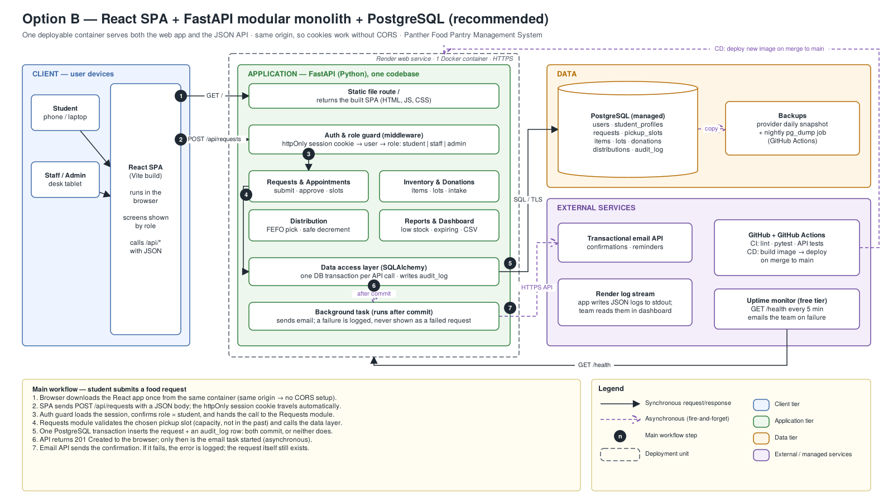

# Panther Food Pantry Management System

**Backend update (PFPMS-1–4):** Auth, profiles, role/access management and student
request submission now use Supabase. See [setup and integration instructions](docs/supabase-backend.md).
The FastAPI/Docker architecture below is the original scaffold; the team is moving
to Supabase. Frontend screens still need to connect to the supplied integration helpers.

A web application that replaces the university food pantry's paper forms and spreadsheets with one role-based system for **students**, **pantry staff** and **administrators**: assistance requests with pickup slots, inventory by lot and expiry date, donations, distributions and reports.

CINS 5318 Software Engineering · Prairie View A&M University · Fall 2026 · Group project



## Architecture in one paragraph

A **React single-page app** and a **FastAPI modular monolith** ship as **one Docker container** over **PostgreSQL**. The API lives under `/api`, the React app under `/`, so they share one origin and use an httpOnly session cookie. Code is split into modules (requests, inventory, distribution, reports) that share one database. The rule the whole design protects: **a lot's `qty_on_hand` is never negative and always equals the sum of its ledger entries.** Full rationale, the three rejected options and all diagrams: [`docs/architecture`](docs/architecture/README.md) and the complete [design document](docs/architecture/design.md).

## Project documents

| Document | File |
| --- | --- |
| Project proposal | [docs/course/Project_Proposal.docx](docs/course/Project_Proposal.docx) |
| Homework 2 — SE tools report | [docs/course/Homework2_SE_Tools_Report.pdf](docs/course/Homework2_SE_Tools_Report.pdf) |
| Architecture design | [docs/architecture/design.md](docs/architecture/design.md) |
| Architecture presentation | [docs/presentation/Panther_Food_Pantry_Architecture.pptx](docs/presentation/Panther_Food_Pantry_Architecture.pptx) |
| Editable diagrams (draw.io) | [docs/architecture/diagrams/](docs/architecture/diagrams/) |

## Run it locally

Requirements: [Docker Desktop](https://www.docker.com/products/docker-desktop/) and Git.

```bash
git clone <this repo>
cd panther-food-pantry
docker compose up
```

| URL | What |
| --- | --- |
| http://localhost:5173 | React app (hot reload) |
| http://localhost:8000/api/health | API health check |
| http://localhost:8000/api/docs | Interactive API documentation |

Without Docker (backend only):

```bash
cd backend
python -m venv .venv && source .venv/bin/activate   # Windows: .venv\Scripts\activate
pip install -r requirements-dev.txt
pytest
uvicorn app.main:app --reload
```

## Repository layout

```
backend/            FastAPI app (Python 3.12)
  app/api/          one router per module
  app/core/         settings
  app/db/           database engine and sessions
  tests/            pytest
frontend/           React + Vite
docs/architecture/  design rationale, decisions, draw.io diagrams
Dockerfile          production image (React build + API in one container)
docker-compose.yml  local development stack
.github/workflows/  CI: lint, tests, frontend build, Docker smoke test
```

## Team

| Area | Members |
| --- | --- |
| Project management + requirements | Cecilio, Damario Johnson |
| Frontend (React) | Samuel, Alvi Anowar |
| Backend + database (FastAPI) | Oluwafemi Bamidele, Joshua Gado |
| DevOps + testing | Franck Darole |
| Integration, documentation + presentation | Usman Jibril |

How we work: [CONTRIBUTING.md](CONTRIBUTING.md).
