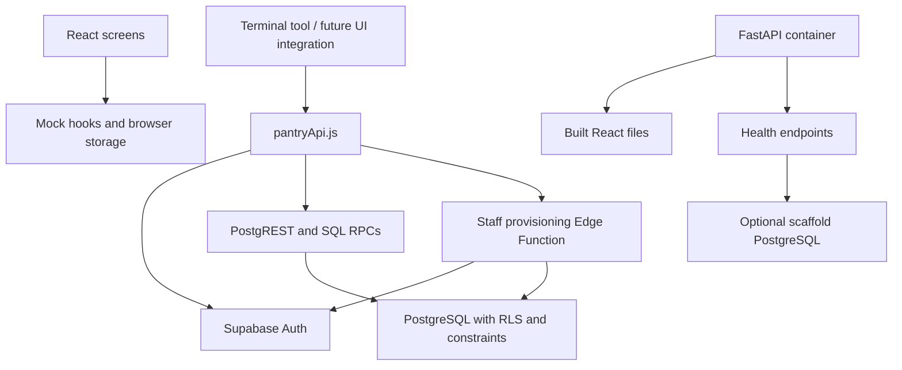

# Current stack and integration boundaries

Updated October 22, 2026, against the merged frontend and Supabase backend code.
Dependency manifests and SQL sources are authoritative for exact versions and contracts.

## Implemented components

| Layer | Technology | Responsibility |
| --- | --- | --- |
| UI | React 18.3.1, JavaScript/JSX, Vite 6.4.5 | Student, staff, and admin portals with hash navigation |
| UI components/styles | HeroUI, Tailwind CSS 4, feature CSS, Framer Motion, react-hot-toast | Controls, dialogs, animation, and notifications |
| Demo state | React hooks and browser localStorage | Current screen authentication, records, and simulated workflows |
| Business backend | Supabase Auth, PostgreSQL, PostgREST, RLS, SQL RPC functions | Accounts, access control, requests, and inventory |
| Privileged service | Supabase Edge Function, TypeScript/Deno | Admin-authorized staff provisioning |
| Retained server | Python 3.12, FastAPI, Uvicorn, SQLAlchemy 2, psycopg 3, pydantic-settings | Health checks, optional database readiness, built UI hosting |
| Development/CI | Node.js 22, npm, Prettier, Node test runner, pytest, Ruff, Docker, GitHub Actions | Tests, formatting, builds, and container smoke checks |

The current screen controllers do not call `getPantryApi()`. Installing the SDK or
setting frontend environment variables does not switch the demo to live data.
The terminal tool already calls the shared service independently of the UI.

## Backend contracts and integration gaps

| Area | Implemented Supabase contract | Current UI / remaining work |
| --- | --- | --- |
| Authentication | University email plus a separate pantry password; Auth users and live application roles | UI uses sample/mock accounts; integrate registration, email confirmation, session lifecycle, and workspace checks |
| Student identity | Staff/admin assign student IDs after acknowledging physical verification; audited SQL operation | Map backend UUIDs and verified student IDs to UI profiles |
| Requests | One to ten food categories, optional logistics note, server-controlled ownership and initial `submitted` status | UI selects a food item and pickup slot with `Waiting`/`Approved` states; agree on a contract before integration |
| Inventory | Catalog items, dated/storage-located lots, atomic integer stock changes, append-only history | UI uses local inventory shapes; adapt IDs, field names, and errors to the service |
| Availability | Active, received, unexpired in-stock catalog availability for active signed-in users | UI availability comes from demo inventory |
| Users | Admin listing, role/access changes, last-admin protection, private staff invitations | Replace mock user actions; configure the Edge Function's browser origin before invitation UI integration |
| Pickups/distributions | Stock adjustment RPC exists; no complete pickup/distribution transaction contract | Slot capacity, request approval, and multi-item pickup completion remain mock workflows |
| Donations/reports/audit | Access, identity, and stock history exist | Full donation, report, and operational audit screen contracts still need implementation/integration |

RLS and database functions enforce backend permissions. Client role checks are for
navigation and feedback, not authorization. The supplied browser client uses
Supabase Auth sessions; the proposed FastAPI httpOnly-cookie/argon2 authentication
system has not been implemented. Campus SSO remains an open requirement.

## Local development and deployment boundaries

- Run the UI demo with `npm ci` and `npm run dev` in `frontend/`.
- Run `node scripts/pantry-terminal.mjs` there to exercise the Supabase backend.
  Follow [the backend guide](../supabase-backend.md) for real accounts and setup.
- `frontend/.env.example` contains the public URL and publishable key consumed by
  `src/lib/supabase.js`. Vite embeds `VITE_*` values at build time. Service-role
  secrets belong only in the Edge Function/server environment.
- `docker compose up` runs Vite, FastAPI, and PostgreSQL 16. That PostgreSQL service
  is separate from hosted Supabase and does not include Supabase Auth or its API.
- The production Dockerfile builds React and serves it through FastAPI. It does
  not deploy the SQL sources or Edge Function. CI builds/smoke-tests the image;
  it does not automatically deploy it.
- `/api/health` checks the FastAPI process; `/api/health/db` checks the database
  configured by `DATABASE_URL`. Neither confirms Supabase Auth or RLS correctness.

The shared Supabase project is already provisioned according to the backend setup
guide. Do not rerun fresh-project create-table scripts against it. See that guide
for SQL application order, the student-ID upgrade, and private staff invitations.

## Verification

In `frontend/`, `npm test` runs UI domain and Supabase helper/handler tests using
Node's built-in test runner. `npm run build` validates the bundle. These checks do
not exercise hosted Supabase or prove the screen integration is complete.

In `backend/`, install `requirements-dev.txt`, then run `ruff check .`,
`ruff format --check .`, and `pytest -q` for the retained Python scaffold.
CI also builds Docker and checks `/api/health`.

CI runs SQL access/inventory and concurrency checks in disposable PostgreSQL
using `node scripts/test-database.mjs` and a test-only Auth stand-in. These checks
do not exercise hosted Auth, PostgREST, or Edge Functions. The authorized live
runner remains separate; see [the backend guide](../supabase-backend.md) and the
[system acceptance checklist](../acceptance-tests.md).

The [October 8 proposal](design.md), original diagrams, and course presentation
remain historical design artifacts. Their planned FastAPI modules, cookie
authentication, and end-to-end distribution API do not describe the current code.
