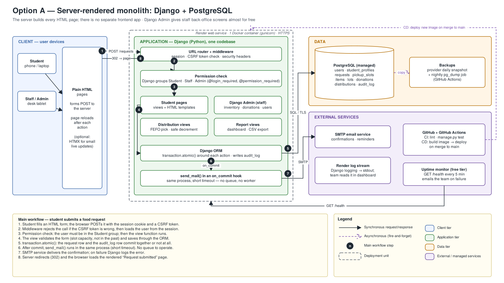
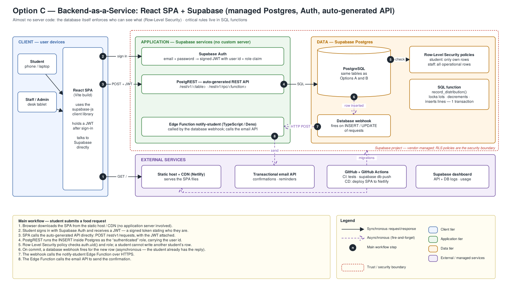
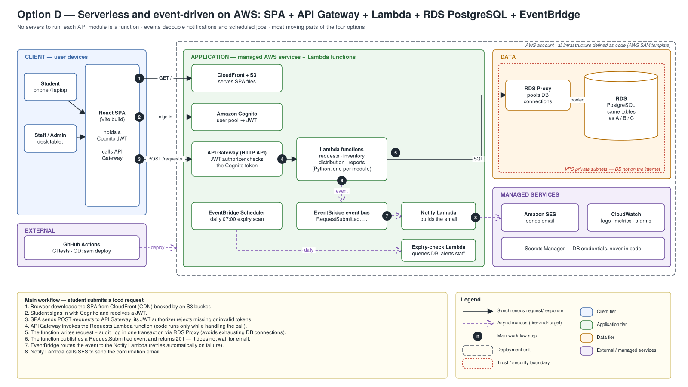
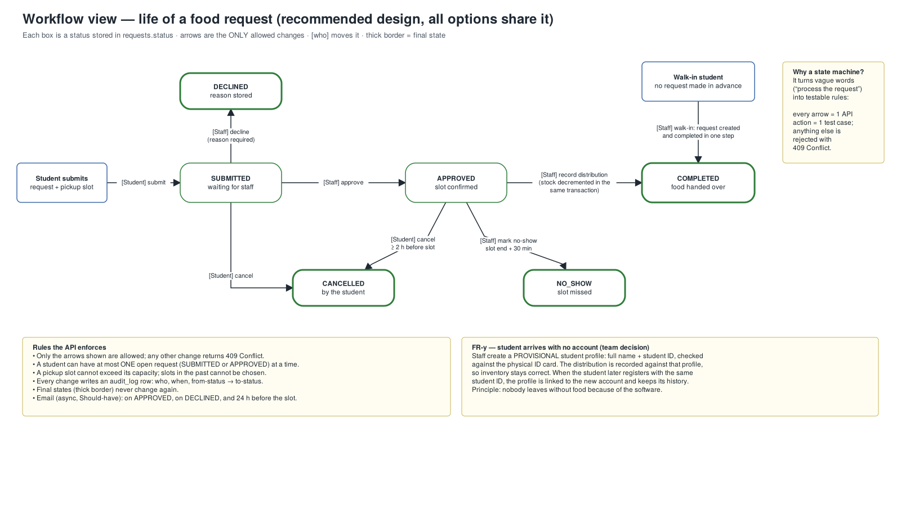
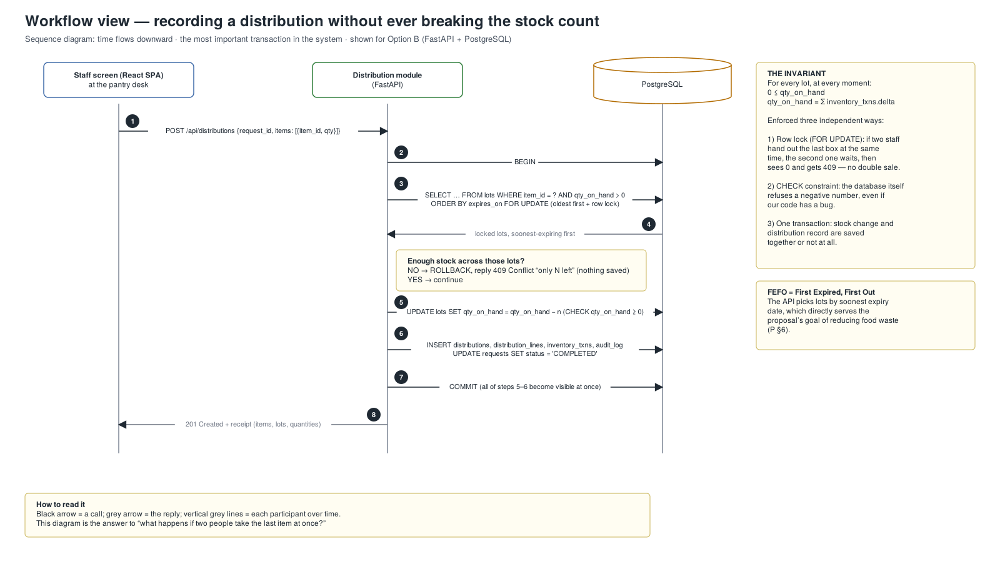
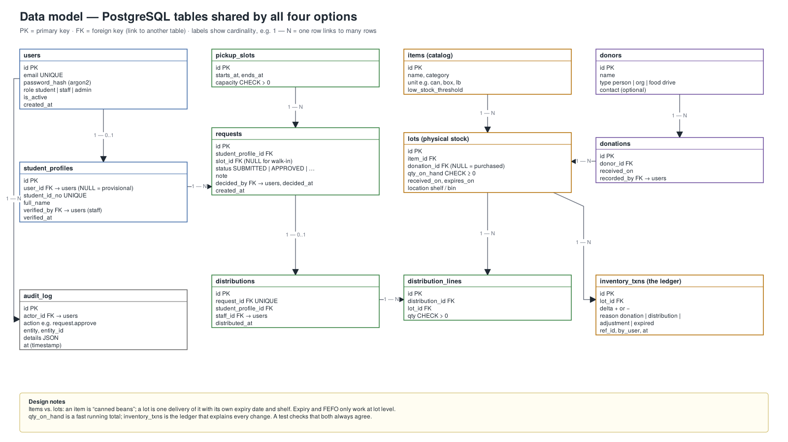

# Panther Food Pantry — Architecture Design

> Historical October 8 proposal. Read [Current stack and integration boundaries](current-stack.md) for the merged implementation. Supabase supplies the business backend; the FastAPI business modules and cookie authentication described below are not implemented. The screens still use mock data pending integration.

Oct 8, 2026 · Franck Darole

Build **Option B**: a React single-page app and a FastAPI "modular monolith" in one Docker container, backed by PostgreSQL. It matches the tools the team already committed to in Homework 2, splits cleanly across 8 people, and is small enough to finish by the Nov 19 final presentation.

Sources: Project Proposal (P §1–§8, [`docs/course/Project_Proposal.docx`](../course/Project_Proposal.docx)) and Homework 2 tools report (H p.1–7, [`docs/course/Homework2_SE_Tools_Report.pdf`](../course/Homework2_SE_Tools_Report.pdf)).

## Decisions

The proposal left these open, so they are decided here. Each one can be reversed, but changing it later costs more than changing it now.

| # | Question | Decision | Why |
| --- | --- | --- | --- |
| 1 | Language and framework | **Python + FastAPI** backend, **React (Vite, JavaScript)** frontend | Python is the most common first language for the team; FastAPI generates API docs automatically. React is the most-taught UI library, so the two UI members can find help easily. |
| 2 | Database | **PostgreSQL** | The data is relational (students → requests → distributions → lots). Postgres gives transactions, row locks and CHECK constraints, which protect the stock count. |
| 3 | Architecture | **Option B**: one container serving both the React app and the API | Simple to run and deploy, and the module boundaries still let 8 people work in parallel. |
| 4 | Hosting for the demo | A free-tier platform (e.g. Render + a managed Postgres such as Neon) + **local `docker compose` as a fallback** | Budget assumed $0. Free tiers may sleep when idle and limits change, so open the site 5 minutes before presenting and keep the local copy ready. |
| 5 | Login | The app's **own email + password accounts**, not PVAMU single sign-on | Campus SSO needs IT approval that won't arrive by Nov 19. Passwords hashed with argon2; sessions use an httpOnly cookie. |
| 6 | Who can register | Students only, with a **@pvamu.edu email**; staff confirm the student ID card at first visit | The app can't check enrollment by itself, so a person does it once and the system records who verified. |
| 7 | Students without an account (FR-y) | Accounts are required; staff help students create one at the desk. If that fails, staff record the visit against a **provisional profile** (name + student ID), linked later | Inventory stays accurate and nobody leaves without food because of the software. |
| 8 | Requests vs. appointments | **One object**: a request always includes a pickup slot; staff approval confirms the slot | One status field instead of two linked records. Fewer bugs and fewer screens. |
| 9 | Inventory detail | **Items** (catalog) + **lots** (each delivery with its own expiry date and shelf location); single pantry site | Expiry alerts and first-expired-first-out only work if each delivery is tracked separately. |
| 10 | Notifications | **In-app status** in the MVP; **email** as a Should-have; no SMS | SMS costs money and adds a vendor. |
| 11 | Expiry and low-stock alerts | **Computed when the dashboard loads**, no scheduled job | A query is simpler than a scheduler and fast at pantry scale. |
| 12 | Process model | **Scrum-style, 1-week sprints** tracked in Jira | Short loops fit a 6-week window. Matches the Jira choice in Homework 2. |
| 13 | API testing tool | **Bruno** instead of Postman | Postman's free plan is one user (H p.3); Bruno stores collections in Git and needs no account. |

## What the proposal requires

| Area | Requirement | Source | Stated or assumed |
| --- | --- | --- | --- |
| Accounts | Registration, secure login, role-based access | P §3 | Stated |
| Student | View food availability, request help, book and manage a pickup, see status and history, get notifications | P §3–§5, H p.1 | Stated |
| Inventory | Quantity, category, location, received and expiry dates; low-stock and expiring flags | P §3, §5 | Stated |
| Donations | Donor and quantity recorded; stock goes up | P §3–§4 | Stated |
| Distribution | What each student received; stock goes down | P §3–§4, H p.1 | Stated |
| Admin | Process requests, dashboard, searchable records, operational reports, oversee users | P §3, H p.1 | Stated |
| Quality | "Secure, accessible"; accuracy and accountability | P §2–§3 | Stated, but no targets |
| Privacy | Who sees a student's pantry history, and for how long | — | Assumed: student sees own; staff see operational data; reports are aggregate counts only |
| Scale | Users and traffic | — | Assumed: one pantry, a few hundred students, tens of visits a day, 1–5 staff online |
| Deadline | Sep 30 – Nov 20 timeline; final presentation Nov 19 | P §7; syllabus | Conflict by one day: plan to Nov 18 |
| Tools | Jira, Figma, VS Code, GitHub + Actions, Postman, Docker | H p.5 | Stated (Postman swapped for Bruno) |

Gap that documents can't close: nobody has interviewed the pantry yet. One 30-minute conversation with pantry staff is the highest-value task before the requirements presentation.

## Option A — Server-rendered Django monolith

The server builds every HTML page, and Django Admin provides most staff screens without custom code. Fastest way to a working system; least to show senior engineers.

| Aspect | Detail |
| --- | --- |
| Approach | **Monolith**: one application, one codebase, one deployable unit. **Server-rendered**: the server sends finished HTML; the browser only displays it and submits forms. |
| Components | Django (routing, views, templates, ORM, auth, admin) · PostgreSQL · SMTP email · GitHub Actions · Render · uptime monitor |
| Request path | Form POST → CSRF and session check → group permission → view → `transaction.atomic()` → email after commit → redirect to a rendered page |
| Security | Session cookie + CSRF built in; Django groups for roles; HTML escaping by default |
| Operations | One container; stdout logs; `/health` pinged by a monitor; provider backups + nightly `pg_dump` |
| Limits and cost | Far beyond pantry scale. Email runs inside the request, so a slow mail server slows the click. |
| Advantages | Least code; admin screens almost free; one language |
| Disadvantages | No separate API, so the API-testing plan weakens; UI feels dated; two UI members have less to own |
| Choose it when | The team is weak in JavaScript or time is cut in half. **The fallback if Option B slips.** |

## Option B — React SPA + FastAPI modular monolith (recommended)

One Docker container serves the React app at `/` and a JSON API at `/api/*`, organized as separate internal modules over one PostgreSQL database.

| Aspect | Detail |
| --- | --- |
| Approach | **SPA**: the browser downloads the app once, then exchanges JSON with the server. **Modular monolith**: one deployable, code split into modules (requests, inventory, distribution, reports) that talk only through defined functions, never each other's tables. |
| Components | React SPA · FastAPI (static route, auth guard, 4 modules, SQLAlchemy data layer, background email task) · PostgreSQL · email API · GitHub Actions · Render · uptime monitor |
| Request path | Load the SPA → `POST /api/requests` with cookie → role check → Requests module validates the slot → one transaction writes request + audit row → 201 returned → email sent after commit |
| Security | **Same origin**, so the session is an httpOnly, Secure, SameSite=Lax cookie JavaScript can't read, and no CORS rules are needed. Every endpoint declares its allowed roles; students can only query their own records (tested). argon2 password hashing; login rate-limited. |
| Operations | Stdout logs, `/health`, uptime pings, backups. CI runs lint, pytest and API tests on every pull request; merge to `main` deploys. |
| Limits and cost | One container handles far more than one pantry needs; run a second copy behind the load balancer to grow. |
| Advantages | Clean frontend/backend split for 8 people; auto-generated API docs; API tests fit the Homework 2 plan; same API could later serve a mobile app |
| Disadvantages | Two languages; more code than A |
| Choose it when | The team wants a modern, defensible design that is still finishable in six weeks. **This project.** |

## Option C — Backend-as-a-Service with Supabase

The React app talks directly to Supabase: hosted Postgres plus login, an auto-generated REST API and serverless functions. Almost no server code, but security moves into database policies.

| Aspect | Detail |
| --- | --- |
| Approach | **BaaS**: a vendor runs auth, API and database. **Row-Level Security (RLS)**: per-table rules that filter every query by who is asking. |
| Components | React SPA on a static host · Supabase Auth · PostgREST · Postgres with RLS and a `record_distribution()` SQL function · database webhook · Edge Function · email API · GitHub Actions |
| Request path | SPA from CDN → sign in, receive JWT → `POST /rest/v1/requests` with JWT → INSERT as authenticated role → RLS check → webhook → Edge Function → email |
| Security | The browser talks straight to the database API, so **one missing RLS policy exposes a table to every logged-in student**. |
| Limits and cost | Free tier fine for a demo; free projects can pause. Logic split between SQL and TypeScript. |
| Advantages | Fastest to login and CRUD; built-in auth |
| Disadvantages | Vendor lock-in; RLS and SQL functions hard to unit-test; Docker plan barely applies |
| Choose it when | A tiny team must ship CRUD fast and someone is strong in SQL. |

## Option D — Serverless and event-driven on AWS

Each API module is a Lambda function behind API Gateway; notifications and daily expiry scans run on events. Far more infrastructure than a single pantry needs; included to show it was considered and rejected.

| Aspect | Detail |
| --- | --- |
| Approach | **Serverless**: code runs only when called. **Event-driven**: a function publishes "RequestSubmitted" and other services react without the caller waiting. |
| Components | CloudFront + S3 · Cognito · API Gateway (JWT authorizer) · Lambda per module · RDS Proxy + RDS PostgreSQL in a private VPC · EventBridge + Scheduler · SES · CloudWatch · Secrets Manager · AWS SAM · GitHub Actions |
| Security | Token checked before code runs; private database; per-function IAM. Strongest isolation, easiest to misconfigure. |
| Limits and cost | Scales furthest. **Conflicts with $0**: RDS is free only in the first year, and VPC Lambdas need paid networking to reach the internet. Cold starts. |
| Choose it when | Many campuses share one system, traffic is spiky, the budget is real and someone knows AWS. |

## Comparison and recommendation

Ratings are judgments with the reason in the cell, not measured scores.

| Criterion | A — Django | B — SPA + FastAPI | C — Supabase | D — AWS serverless |
| --- | --- | --- | --- | --- |
| Fit with proposal + H2 tools | Good; weak API testing | **Best**; uses every tool | Fair; Docker and API tests unused | Fair; breaks $0 budget |
| Implementation complexity | **Lowest** | Medium | Low CRUD, hard policies | **Highest** (~12 services) |
| Cost drivers | 1 web service + 1 DB | Same as A | Paid plan past free tier | RDS, networking, requests |
| Scalability | Campus-level; add copies | Same as A | Vendor scales; plan limits | **Highest** |
| Reliability | 1 container; auto-restart | Same as A | Vendor-run; free tier pauses | Managed + retries; many parts |
| Security | Strong defaults | Strong with role tests | Only as good as policies | Strongest; easy to misconfigure |
| Maintainability | High | High; clear modules | Medium; logic split | Low for this team |
| Beginner feasibility | **High** | High | Medium | Low |

**Recommendation: Option B.** The team chose Postman for API testing and Docker + GitHub Actions for delivery (H p.3–5), and the proposal assigns two frontend and two backend developers (P §8). Option B is the design where each of those choices and roles has real work to do.

When to switch:

- **To A**: if by Oct 29 one feature isn't working end-to-end on the deployed site.
- **To C**: if the pantry wants a phone-first app quickly and no one will maintain a server.
- **To D**: many campuses, spiky traffic, a paid AWS budget and AWS skills.
- **Split B into services**: only when separate teams must deploy modules independently.

## Workflows and data model

**Request lifecycle.** Six statuses with fixed allowed changes; each arrow is one API action and at least one test.

**Distribution transaction — the invariant.** For every lot, `qty_on_hand` is never negative and always equals the sum of its ledger entries. Enforced by a row lock, a CHECK constraint and one transaction.

**Data model.** 12 PostgreSQL tables. Key idea: **items vs. lots** — "canned beans" is an item; each delivery is a lot with its own expiry date and shelf.

## MVP scope

The MVP is the full loop **donation in → request → approval → distribution out → stock correct**, demonstrated live.

| Priority | Feature | Source |
| --- | --- | --- |
| Must | Register / log in / log out; roles student, staff, admin; staff-assisted registration | P §3 |
| Must | Provisional profile for walk-ins without an account (FR-y) | Team decision |
| Must | Item catalog + lots (quantity, category, shelf, received and expiry dates) | P §3 |
| Must | Record a donation → creates lots → stock goes up | P §3–§4 |
| Must | Student: see available categories, submit request with pickup slot, see status and history | P §3–§5 |
| Must | Staff: approval queue (approve / decline with reason), mark no-show | P §3 |
| Must | Record distribution with FEFO lot selection and safe stock decrement | P §3–§4 |
| Must | Dashboard: low-stock items, lots expiring in 7 days, today's pickups | P §3, §5 |
| Must | Audit log of every staff action | P §3 |
| Should | Email on approve / decline + 24 h reminder | P §3 |
| Should | Reports: monthly distributions by category, donations by donor type, CSV export | P §3, §6 |
| Should | Admin: manage users and roles | H p.1 |
| Could | Dashboard charts; search across all records | P §3 |
| Won't (this term) | SMS, barcode scanning, campus SSO, multiple pantry sites, mobile app | — |

## Implementation plan

| Sprint | Dates | Done when | Learn first |
| --- | --- | --- | --- |
| 0 | Oct 8–14 | `docker compose up` runs everything on every laptop; CI on pull requests; Jira board and Figma wireframes; tables created by migrations | Git branches and PRs; Docker Compose; FastAPI basics; Alembic |
| 1 | Oct 15–21 | Login and roles; items, lots, donations from the UI; requirements doc final | Password hashing; cookie sessions; SQLAlchemy relationships; React Router |
| 2 | Oct 22–28 | Requests, slots, approval queue; every allowed and forbidden status change tested | State machines; pytest fixtures; Bruno |
| **Checkpoint** | Oct 29 | One feature works end-to-end **on the deployed site**, or switch to Option A | — |
| 3 | Oct 29 – Nov 4 | Distribution with FEFO + row locking, concurrency test; provisional profiles; student history | Transactions; `SELECT … FOR UPDATE` |
| 4 | Nov 5–11 | Dashboard, reports, CSV, email, audit viewer, admin; accessibility pass | Aggregate SQL; background tasks; WCAG basics |
| 5 | Nov 12–18 | **Freeze Nov 15.** Bugs only; demo data; two rehearsals; paper | Demo scripting |

Team split (P §8): Cecilio + Damario — Jira, requirements, pantry interview. Samuel + Alvi — React screens. Oluwafemi + Joshua — FastAPI modules and schema. Franck — Docker, CI/CD, deployment, test suite. Usman — integration tests, documentation, presentation.

## Questions senior engineers will ask

| Question | Honest answer |
| --- | --- |
| Why not microservices? | One pantry, 8 students, 6 weeks. Microservices add network calls, deployments and failure modes. Modules have clean boundaries, so splitting later is possible. |
| Two staff give out the last item at once? | Both lock the same lot rows with `SELECT … FOR UPDATE`. The second waits, sees zero and gets 409. A CHECK constraint stops negatives even if code is wrong. A test runs both at once. |
| Single container = single point of failure? | Yes. The platform restarts it and the pantry can use paper for a few minutes. Two copies behind a load balancer work because the app keeps no state in memory. |
| Why cookies instead of JWTs? | App and API share one origin, so an httpOnly cookie is simpler and safer: JavaScript can't read it, and sessions can be revoked. JWTs help when many services verify tokens independently. |
| How do you protect student privacy? | Own-records-only access, tested. Reports show counts, not names. Staff actions audited. No reason-for-need collected. Gap: retention policy, to set with the pantry. |
| What if email is down? | Email runs after commit, so the request is already saved; the failure is logged. A queue with retries is the next step if delivery mattered more. |
| How would this scale to every campus? | Add `pantry_id`, run more copies, add read replicas for reports. Option D starts to earn its cost there. No traffic data yet, so no guesses. |
| How do you know it works? | Unit tests per module, tests for every allowed and forbidden status change, the concurrency test, and API tests in CI on every pull request. |
